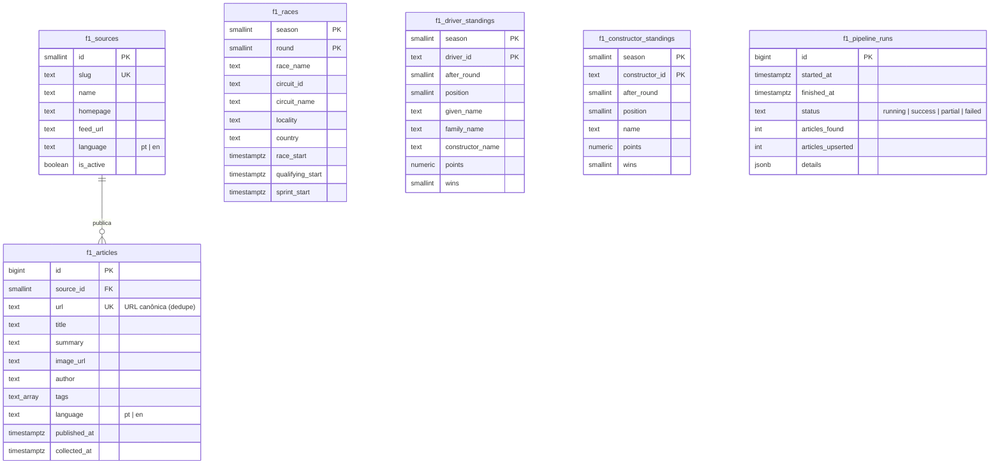

# Modelagem de dados

Banco: Postgres do Supabase, schema `public`, tabelas com prefixo `f1_`.
Migrações versionadas em [`db/migrations`](../db/migrations), aplicadas automaticamente pelo pipeline
(controle em `f1_schema_migrations`).

## Decisões

| Decisão | Motivo |
|---|---|
| `f1_articles.url` único, após remover `utm_*`, `at_*` e fragmentos | Deduplicação entre execuções; `upsert` idempotente |
| `language` na fonte **e** no artigo | Filtro rápido por idioma com índice `(language, published_at desc)` |
| View `f1_news_feed` com `security_invoker` | O front faz uma única consulta e as políticas RLS continuam valendo |
| Classificações como *snapshot* por `(season, id)` | O painel mostra só a tabela atual; `after_round` indica a etapa |
| `f1_pipeline_runs` sem política RLS | Auditoria privada: o papel `anon` não lê nem escreve |
| Retenção de 90 dias (`RETENTION_DAYS`) | Mantém o banco pequeno no plano gratuito |

## Segurança

- RLS ativo em todas as tabelas; `anon`/`authenticated` têm apenas `SELECT` nas tabelas públicas.
- A chave *publishable* usada no `index.html` é pública por design; a escrita só acontece pelo
  pipeline, com a `DATABASE_URL` guardada como segredo do GitHub Actions.
